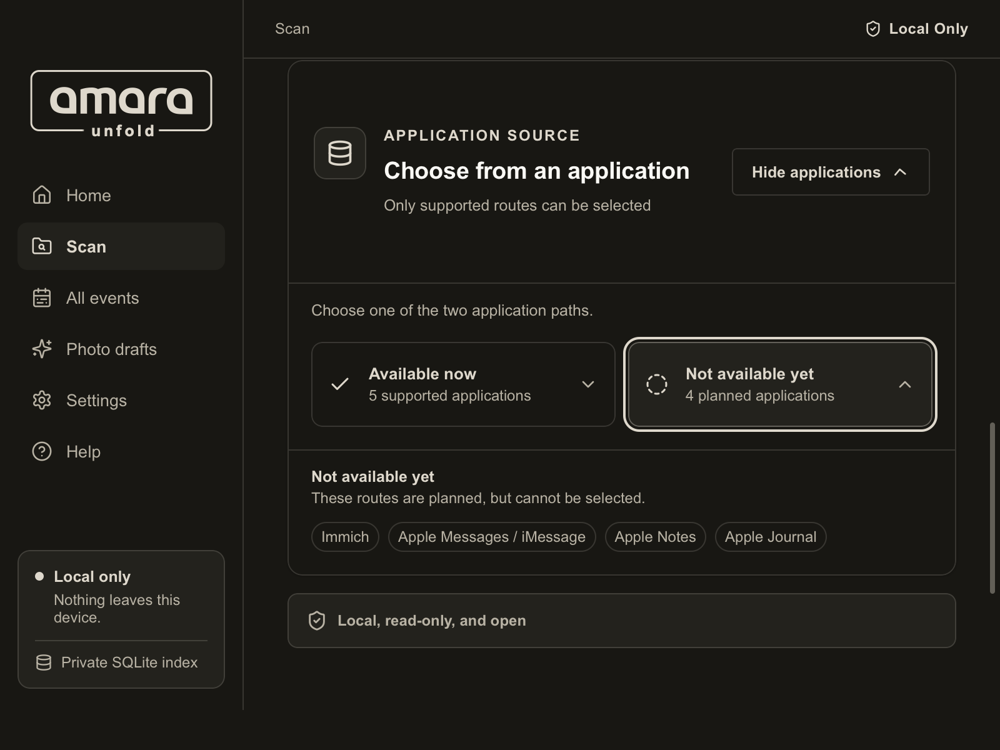

<div align="center">

<picture>
  <source media="(prefers-color-scheme: dark)" srcset="assets/public-readme/amara-unfold-flat-mocca.svg">
  
</picture>

# amara Unfold

**Your data. Your memories. Open files.**

Turn selected digital exports into readable Markdown, on your own computer.

[Mac preview download](https://github.com/amara-gmbh/amara-unfold/releases/tag/v2026.9.21-mac-preview.2) · [amara GmbH](https://amara.gmbh) · [amara Unfold](https://amaraunfold.de)

</div>

## Unfold your digital history

Digital life is scattered across apps, devices and services. amara Unfold helps
you turn supported exports into files you can read, search and keep. It is a
local-first desktop application and command-line tool, designed to make your
own information more accessible without locking it into a proprietary format.

## See amara Unfold




## What it does

- Recognises supported formats from selected folders and exports.
- Creates readable Markdown and supporting manifests and indexes.
- Brings eligible records together in a local timeline, with source evidence.
- Keeps originals unchanged and retains the output as files you can use
  independently.

Support depends on the source and export format. Recognition alone does not
guarantee complete conversion, and not every source or variant is supported.

## Privacy

Unfold is designed for local processing of the sources you choose. Generated
files and the local index can contain personal information, so protect them
with your normal device and storage security. Review the privacy documentation
for the exact release before relying on a specific guarantee.

## Build from source

On an Apple silicon Mac, install the Xcode Command Line Tools, Rust and Node.js
22.13 or newer. From a local, non-synchronised copy of the reviewed source:

```sh
npm ci
npm run build
npm test
npm run build:app:debug
```

The debug app is created at `target/debug/bundle/macos/Amara Unfold.app`. It is
ad-hoc signed for local testing, not an official notarized Mac download. See
[build instructions](docs/build-from-source.md), the [user guide](docs/how-to-use.md),
and the [privacy model](docs/privacy.md) for details and supported formats.

## Availability

An [Apple silicon Mac preview](https://github.com/amara-gmbh/amara-unfold/releases/tag/v2026.9.21-mac-preview.2) is available.
It is ad-hoc signed, not Apple Developer ID signed or notarized; macOS Gatekeeper
may block it on first launch. The build instructions above create a local debug app.

## Licence

The source is licensed under **GNU AGPL-3.0-or-later**. See [LICENSE](LICENSE)
and [NOTICE.md](NOTICE.md) for details and third-party notices.

---

Made by [amara information security GmbH](https://amara.gmbh).
