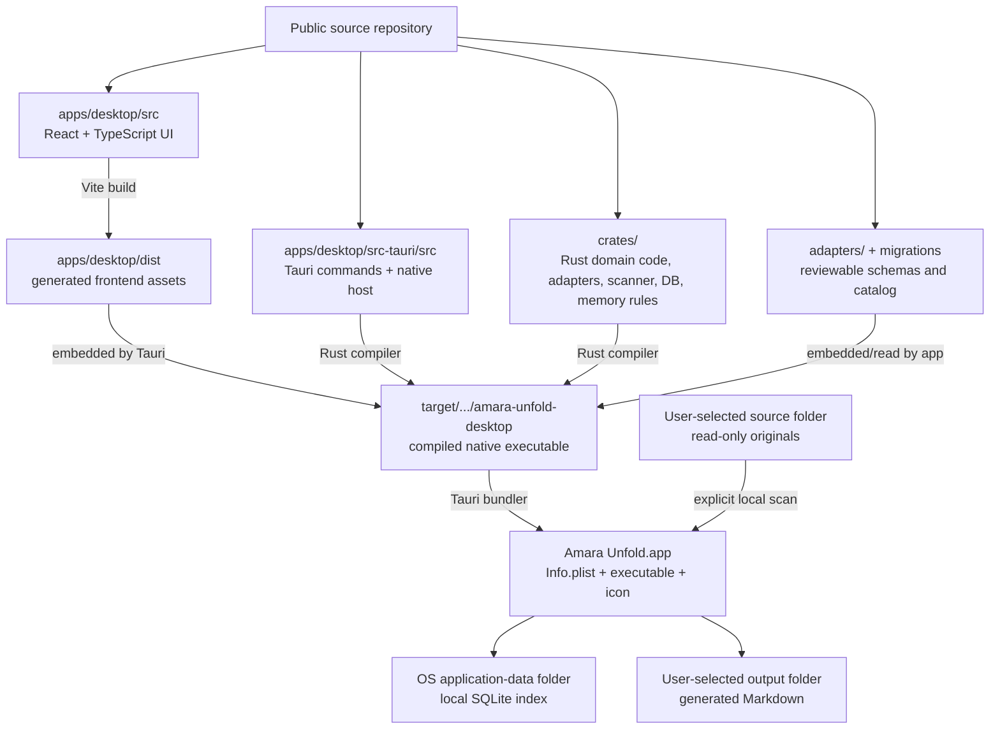

# Repository, build, and app structure

Amara Unfold has four deliberately separate layers: editable source, generated
build files, the compiled application, and the user's runtime data. Only the
first layer belongs in the public source repository.



## What belongs in the public repository

```text
amaraUnfold/
├── .github/workflows/        Public continuous-integration policy
├── adapters/                 Adapter catalog and its JSON schema
├── apps/desktop/
│   ├── src/                  Editable React/TypeScript interface
│   └── src-tauri/
│       ├── capabilities/     Native permission declarations
│       ├── icons/            Reviewed application artwork
│       ├── src/              Editable Rust host code
│       └── tauri.conf.json   Bundle identity and app version
├── assets/                   Editable brand artwork
├── crates/
│   ├── adapters/             Input recognition and Markdown generation
│   ├── core/                 Models, interfaces, and network guard
│   ├── db/                   SQLite repository and migration
│   ├── extractors/           Local metadata extraction
│   ├── memory/               Deterministic evidence rules
│   └── scanner/              Read-only traversal and hashing
├── docs/                     Public design and operating documentation
├── scripts/                  Auditing and packaging tools
├── tests/                    Browser and native acceptance tests
├── Cargo.lock                Pinned Rust dependencies
└── package-lock.json         Pinned JavaScript dependencies
```

The source repository is enough to inspect, test, and build the application.
Generated dependencies and compiler output are intentionally absent.

## What a build creates

`npm run build` type-checks the UI and creates `apps/desktop/dist/`. Tauri then
compiles the native host and Rust crates under `target/`. Neither directory is
source, and both are ignored by Git.

On macOS, `npm run build:app:debug` creates this bundle:

```text
target/debug/bundle/macos/Amara Unfold.app/
└── Contents/
    ├── Info.plist
    ├── MacOS/
    │   └── amara-unfold-desktop
    └── Resources/
        └── icon.icns
```

The frontend assets are embedded into the native executable by Tauri. The
`.app` bundle is a distributable build result; it is not the source code and
cannot replace the repository for review or development.

## What remains outside the app

The source archives selected by the user remain where they already are. The app
opens originals read-only and never packages them into the `.app`.

The local index is created in the operating system's application-data folder.
On macOS the default is:

```text
~/Library/Application Support/com.amaramemory.unfold/amara-unfold.db
```

Generated Markdown is written only to the output folder chosen by the user.
The runtime database, input folders, and generated output are personal data and
must never enter the source repository.

## Version identifiers

- App version: `YYYY.M.D`, for example `2026.7.19`
- macOS bundle build number: `YYYYMMDDHHMM`, for example `202607191435`

The app version is kept aligned across the root JavaScript and Rust manifests,
the desktop workspace, and `tauri.conf.json`. The minute-precision build number
is stored as `bundle.macOS.bundleVersion` in `tauri.conf.json` so multiple
builds on one day remain auditable.
