# amara Unfold: A-to-Z system guide

This guide explains how amara Unfold works as one complete system. It links to
the narrower contracts where implementation or operating detail belongs.

## 1. Purpose

amara Unfold converts user-selected platform exports and local application
exports into readable, portable Markdown. It preserves useful content,
provenance, source dates, stable identities, and quality information without
turning a person's archive into a hosted service.

The product has two complementary outputs:

1. complete source-specific Markdown catalogues; and
2. a selective cross-source Timeline containing defensible dated events.

Static reference material remains available without being promoted into a
false life event. The output works independently. amara Memory is planned and
not available yet; this release contains no Memory application or import
bridge. A possible future connection is not required to use the files.

## 2. User journey

```mermaid
flowchart LR
    A["Choose raw file, folder, or supported application route"]
    B["Recognize source and format locally"]
    C["Confirm what will be extracted"]
    D["Choose an empty output folder"]
    E["Create source-specific Markdown"]
    F["Validate quality and accounting"]
    G["Build or refresh the open Timeline"]
    H["Keep, search, edit, or remove the local app layer"]

    A --> B --> C --> D --> E --> F --> G --> H
```



The original source is read-only. Removing a layer from the application removes
only its local index entry; it does not delete the raw export or generated
Markdown.

## 3. Input routes

Unfold has two user-facing intake families:

- **Raw data:** the user chooses an export file or extracted export folder.
  Examples include Diary DOCX, Banking Takeout, Airbnb Takeout, and Google Maps
  export variants.
- **Application source:** the user chooses a supported local application route
  or prepares an export through that application. Availability is shown
  honestly; an unverified route remains under **Not available yet**.

Recognition happens before extraction. The UI must name the format actually
found and must not claim that a route works merely because parser code exists.
See [Adapter status](adapters.md) and the
[Open adapter contract](open-adapters.md).

## 4. Source recognition

`adapters/catalog.json` describes open recognition hints, while
`apps/desktop/src-tauri/src/dataset_recognition.rs` applies deeper local
inspection. Recognition is based on structure, extensions, and meaningful
fields—not one user's filename alone.

Mixed Takeouts may expose several independent routes. Multiple representations
of the same provider should converge on one provider identity and deduplicate
using stable source evidence rather than titles alone.

## 5. Extraction and Markdown

The Rust adapter library is shared by the native app and command-line tool.
Each adapter is responsible for:

- parsing a documented source shape;
- preserving readable content and provenance;
- assigning dates only from source evidence;
- generating stable event identities;
- writing portable Markdown and a small manifest;
- accounting for every record as written or skipped with a reason;
- reporting extraction errors and quality honestly.

The portable event contract is documented in
[Open Event Schema v1](schema-v1.md). JSON may support internal parsing or
validation, but Markdown is the primary human-readable output.

## 6. Catalogues, events, and Timeline

A complete catalogue and a useful Timeline are not the same thing.

- **Catalogues** preserve the complete useful source record and relationships.
- **Timeline events** represent genuine dated activity at an appropriate
  precision.
- **Timeless reference notes** preserve useful static information without
  inventing a date.
- **Genuinely undated events** may be manually dated later only when the user
  can verify the date.

Manual dating records an auditable revision while retaining stable identity,
original evidence, raw path/hash, and the original unknown state. Correction
and undo rebuild Timeline indexes without rewriting the raw source.

## 7. Desktop workspace

The React application exposes six calm workspace sections:

| Section      | Responsibility                                                                 |
| ------------ | ------------------------------------------------------------------------------ |
| Home         | Current archive status, recent sources, and direct next actions                |
| Scan         | Source selection, recognition, destination, extraction, and quality            |
| All events   | Readable cross-layer events, provider filtering, and removable archive layers  |
| Photo drafts | Evidence-bound photo event candidates                                          |
| Settings     | Appearance, local database status, and effective privacy settings              |
| Help         | Workflow guidance, supported sources, output, limitations, and troubleshooting |

Source history is part of Home and the local index rather than a seventh
top-level module. Removing a completed archive layer from All events changes
only the rebuildable local catalogue; it does not delete generated Markdown or
raw evidence.

Browser rendering is useful for deterministic UI checks. Final acceptance of
native behavior must use the actual rebuilt Mac application.

## 8. Source modules

| Module/path                  | Responsibility                                                     |
| ---------------------------- | ------------------------------------------------------------------ |
| `apps/desktop/src`           | React views, interaction, formatting, and desktop bridge           |
| `apps/desktop/src-tauri/src` | Native commands, source discovery, recognition, state, and IPC     |
| `crates/adapters`            | Source parsers, Markdown writer, Timeline, validation, and CLI     |
| `crates/core`                | Shared contracts, models, and network-policy placeholder        |
| `crates/scanner`             | Cancellable traversal and hashing without following symbolic links |
| `crates/extractors`          | Local filesystem/image/EXIF metadata extraction                    |
| `crates/db`                  | Bundled SQLite repository and ordered migrations                   |
| `crates/memory`              | Conservative evidence-based candidate generation                   |
| `adapters/catalog.json`      | Open recognition catalogue                                         |
| `crates/db/migrations`       | Rebuildable local index schema                                     |

The detailed runtime boundaries are in [Architecture](architecture.md).

## 9. Local storage and privacy

Content scanning and extraction operate on a user-selected source. Local-app
discovery separately checks known application/export locations and can check
whether other app folders exist; [Privacy model](privacy.md) describes the
scope and Mail discovery lifecycle. The scanner does not follow symbolic links
out of scope, and no upload, telemetry or account feature is configured.
`NetworkGuard` reports status and reserves a future policy boundary; it is not
a runtime firewall or active interception of outbound requests.

SQLite stores a rebuildable private index in the operating system's application
data directory. Generated Markdown is written only to the destination selected
by the user. Neither belongs in the source repository.

See [Privacy model](privacy.md), [Trust and audit](trust-and-audit.md), and
[Repository structure](repository-structure.md).

## 10. Quality and evidence

Every package should balance:

```text
records seen = events written + records skipped
```

Skipped records require named reasons. Quality checks inspect structure,
dates, identities, readability, provenance, duplicates, and source-specific
expectations. A high percentage never overrides a material error or misleading
claim. See [Data quality and validation](quality-and-validation.md).

## 11. Testing

The repository tests four connected layers:

- TypeScript and Rust unit/integration tests;
- browser journeys for deterministic UI states;
- native Tauri acceptance through real IPC and filesystem/database behavior;
- installed-app manual UAT for production-facing routes and appearance.

The public, history, licence, formatting, dependency, build, lint, browser, and
native checks form the deep gate. See [Testing](testing.md).

## 12. Build and distribution

The public repository contains editable source, reviewed assets, configuration,
tests, scripts, and public documentation. It excludes dependencies, compiler
output, app bundles, private test corpora, personal paths, runtime databases,
secrets, and signing material.

A source build can produce an unsigned application. Public binary distribution
additionally requires Developer ID signing, Hardened Runtime, notarization,
stapling, checksums, and source-revision linkage. See
[Build from source](build-from-source.md),
[Component manifest](component-manifest.md), and
[Configuration reference](configuration.md).

## 13. Public history and decisions

The [public changelog](../CHANGELOG.md) records release-facing changes. The
[design and decision record](decisions.md) explains why major choices exist.
Raw private conversations are not required to understand or rebuild the public
application and are not part of the public repository.

## 14. Extending Unfold

A new module must generalize beyond one corpus, remain local-first, use
synthetic public fixtures, preserve source evidence, publish exact accounting,
and pass native application UAT before being advertised as available.

Start with [Open adapter contract](open-adapters.md),
[Contributing](../CONTRIBUTING.md), and
[Configuration reference](configuration.md).
